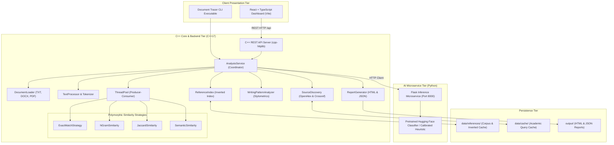

# Document Tracer: System Architecture Specification

## 1. High-Level System Architecture

Document Tracer is architected as a modular, high-performance C++ document-analysis application coupled with a lightweight Python AI microservice and a React TypeScript dashboard.



---

## 2. Multithreading & Producer-Consumer Concurrency Model

Document Tracer uses an industrial-grade producer-consumer worker thread pool satisfying the B.Tech C++ Unit V syllabus requirements.

```mermaid
flowchart TD
    subgraph TaskProducer ["Task Producer"]
        INGEST["AnalysisService::analyzeFile"]
        CAND["ReferenceIndex::findCandidateDocuments"]
        QUEUE["Task Queue (std::queue<std::function<void()>>)"]
    end

    subgraph WorkerPool ["Worker Threads (std::thread pool)"]
        MUTEX["std::mutex queueMutex_"]
        CV_TASK["std::condition_variable cvTask_"]
        W1["Worker Thread 1"]
        W2["Worker Thread 2"]
        W3["Worker Thread 3"]
        W4["Worker Thread 4"]
        ATOMIC["std::atomic<size_t> activeTasks_"]
    end

    subgraph Aggregator ["Thread-Safe Result Aggregation"]
        COLL_MUTEX["std::mutex matchCollectionMutex"]
        RESULTS["std::vector<MatchRecord> allMatches"]
        CV_FIN["std::condition_variable cvFinished_"]
    end

    INGEST --> CAND
    CAND -->|Enqueues Sub-Comparisons| QUEUE
    QUEUE --> MUTEX
    MUTEX --> CV_TASK
    CV_TASK --> W1
    CV_TASK --> W2
    CV_TASK --> W3
    CV_TASK --> W4
    W1 --> COLL_MUTEX
    W2 --> COLL_MUTEX
    W3 --> COLL_MUTEX
    W4 --> COLL_MUTEX
    COLL_MUTEX --> RESULTS
    RESULTS --> CV_FIN
    CV_FIN -->|waitAll() Barrier| INGEST
```

### Key Concurrency Invariants
1. **Producer-Consumer Queue**: `std::queue<std::function<void()>>` synchronized via `std::unique_lock<std::mutex>`.
2. **Worker Signaling**: Workers sleep on `std::condition_variable::wait()` until a task is available or `stop_` is signaled.
3. **Barrier Synchronization**: `waitAll()` blocks the caller until `tasks_.empty() && activeTasks_ == 0`.
4. **Data Race Prevention**: Individual comparison tasks run independently against immutable reference document snapshots and push findings to `allMatches` under `matchCollectionMutex`.

---

## 3. Design Patterns & OOP Architecture

| Pattern | Classes | Description |
|---|---|---|
| **Strategy Pattern** | `SimilarityStrategy`, `ExactMatchStrategy`, `NGramSimilarity`, `JaccardSimilarity`, `SemanticSimilarity` | Polymorphic dynamic dispatch for interchangeable matching algorithms. |
| **Provider Pattern** | `SourceProvider`, `AcademicSourceProvider`, `WebSourceProvider` | Pluggable external source discovery with graceful offline degradation. |
| **Producer-Consumer** | `ThreadPool`, worker threads, task queue | Asynchronous, concurrent execution of comparison workloads. |
| **RAII (Resource Acquisition Is Initialization)** | `DocumentLoader`, `ThreadPool`, `std::unique_lock`, `std::ifstream` | Deterministic acquisition and release of file handles, sockets, and thread joins. |

---

## 4. End-to-End Processing Pipeline

1. **Ingestion**: `DocumentLoader` validates file extension and size, extracts text, handles UTF-8 BOM, and raises custom exceptions if empty or malformed.
2. **Preprocessing**: `TextProcessor` normalizes whitespace, segments sentences with abbreviation awareness, generates sliding passage windows, and creates token sequences preserving exact source offsets.
3. **Inverted Index Lookup**: `ReferenceIndex` performs constant-time hash lookups across candidate documents to eliminate zero-overlap comparisons.
4. **Concurrent Multi-Strategy Comparison**: `ThreadPool` executes exact phrase matching, n-gram containment, Jaccard overlap, and semantic cosine similarity in parallel.
5. **Academic Literature Discovery**: Distinctive passages query OpenAlex and Crossref using polite headers; results are cached locally in `data/cache/academic_cache.json`.
6. **AI Classification & Stylometrics**: Queries `ai_service/app.py` for RoBERTa predictions or calibrated stylometric scoring; `WritingPatternAnalyzer` calculates TTR, burstiness, and entropy.
7. **Report Serialization**: `ReportGenerator` constructs structured JSON and interactive standalone HTML reports with side-by-side passage comparison.
